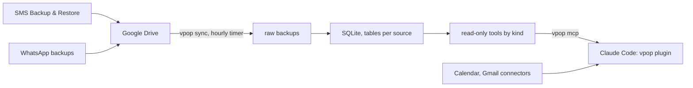

# vPop

**V**alue **P**roductivity **O**ver **P**rivacy.

Instead of asking you to switch to a new productivity tool, this one sits on top of the information channels you already use. You don't need to change anything.

## Overview

vPop lets Claude answer questions about your own messages. It copies the data that has no API (text message and WhatsApp backups from your Android phone) into a local database, keeps it fresh with a background timer, and serves it to [Claude Code](https://code.claude.com/) through read-only tools. You ask Claude, on your own subscription: "what did Sam and I talk about this week?", "who did I text most last month?".

Where Claude already has a connector (Google Calendar, Gmail), vPop doesn't duplicate it: Claude uses the connector.

## Features

- **Text messages**: SMS, MMS and RCS from Android, via SMS Backup & Restore backups on Google Drive.
- **WhatsApp**: Android's end-to-end encrypted backups on Google Drive, decrypted with your backup key. Chats are named from your text message contacts.
- **One search across both**: the tools are by kind, not by app, so one `search_messages` call covers texts and WhatsApp, newest first, and each result says where it came from.
- **Fresh data**: a systemd user timer runs `vpop sync` every hour, and Claude can ask `list_sources` how fresh each source is.
- **Read-only, always**: the tools can't change anything, and vPop asks Google only for read-only access.

## Architecture



`vpop sync` downloads new backups and imports them. The downloaded backups are the source of truth, and the database is derived from them, so it can be rebuilt at any time (`vpop sync --rebuild`). WhatsApp is the exception: each full backup holds your whole history, so only the latest one is kept, and a rebuild loses WhatsApp messages you've deleted on the phone since earlier syncs (it warns).

Claude never sees the database directly. The `vpop` plugin starts `vpop mcp`, an MCP server whose tools search messages (full-text and substring), read a conversation around a message, run read-only SQL for counts, and report how fresh each source is. The plugin's `vpop` skill teaches Claude the workflow and the table layouts.

Code layout (`src/vpop/`):

- `cli.py`: the `vpop` command
- `config.py`, `paths.py`: settings and every file location
- `db.py`: schema, migrations and connections
- `schedule.py`: `vpop schedule`, the systemd user timer
- `sources/`: the `Source` and `Store` interfaces (`base.py`), the list of sources (`registry.py`), `vpop sync` and its status file (`sync.py`), `message_queries.py` (the `MessageStore` that says how a source's message tables are read), and one package per source: `android_messages/` (fetch, parse, store, sync) and `whatsapp/` (fetch, crypt15 decryption, full-backup and increment readers, store, sync); `google/` holds the shared Google OAuth and the Drive client
- `tools/`: the toolbox (`toolbox.py`), the message tools over every message source (`messages.py`), `run_sql` (`sql.py`), `list_sources` (`status.py`) and the MCP server (`server.py`)

At the repository root, `.claude-plugin/` holds the plugin manifest (which declares the MCP server) and the marketplace that lists it, and `skills/vpop/` holds the skill.

## Tools

| Tool | What it does |
| --- | --- |
| `find_conversations` | Finds conversations by contact name, group name or phone number, in every source |
| `search_messages` | Searches every source at once by words, exact substring, conversation, sender, time, direction or source, newest first |
| `read_conversation` | Reads a conversation in order: around a time, forward from one, or the latest messages |
| `run_sql` | Runs one read-only SQL query, for counts, rankings and other aggregates |
| `list_sources` | Lists each source with its message count, its newest message and how its last sync went |

Conversation ids carry their source, e.g. `text:+12405551234` or `whatsapp:120363000@g.us`.

## Setup

Requires Linux with systemd (for the timer), Python 3.12+, [uv](https://docs.astral.sh/uv/) and Claude Code.

### 1. Phone backups

**Text messages.** On your Android phone, install **SMS Backup & Restore** and schedule a daily backup of messages to **Google Drive**. vPop reads XML backups; media is optional.

**WhatsApp (optional).** vPop reads WhatsApp's **end-to-end encrypted** local backups (`msgstore*.db.crypt15`). WhatsApp makes a full backup every few days and a small increment each day in between; vPop reads both, so it's at most a day behind.

1. In WhatsApp, turn on *Settings → Chats → Chat backup → End-to-end encrypted backup* and choose **Use 64-digit encryption key instead**. Write the key down.
2. Get the backups from `Android/media/com.whatsapp/WhatsApp/Databases/` onto Google Drive every day, e.g. with a cron job running `rclone copy`. Older crypt14 files in the folder are ignored.

The backups stay encrypted on disk; each sync decrypts them into a temporary file, imports them, and deletes it. WhatsApp hides some numbers behind privacy ids (`…@lid`); the backup maps most of them back to numbers, and the rest show as the id.

### 2. A Google OAuth client

vPop reads the backup folders with read-only Drive access. In [Google Cloud Console](https://console.cloud.google.com/), create a project, enable the **Google Drive API**, then *APIs & Services → Credentials → Create credentials → OAuth client ID → Desktop app*. Download the JSON and save it as `~/.config/vpop/oauth-client-credentials.json`.

While the OAuth consent screen is in *Testing*, Google expires its tokens after 7 days, and the timer's syncs then fail until you run `vpop auth google` again (`list_sources` and `vpop schedule status` show the error). Publishing the app (*OAuth consent screen → Publish app*) avoids that; for your own account, Google then shows an "unverified app" warning at consent, which you can click through.

### 3. Install vPop

```sh
git clone https://github.com/marcushadeed/vPop.git && cd vPop
uv tool install .        # puts `vpop` on your PATH, for Claude Code and the timer
vpop config init         # writes ~/.config/vpop/config.toml with every setting documented
```

Put the Drive folders' ids (the end of each folder's URL, `https://drive.google.com/drive/folders/<id>`) in the config:

```toml
[android_messages]
drive_folder_id = "<id>"

[whatsapp]
enabled = true            # leave false to skip WhatsApp
drive_folder_id = "<id>"
```

For WhatsApp, save the backup key, readable only by you:

```sh
printf '%s\n' '<the 64 hex digits, no spaces>' > ~/.config/vpop/whatsapp-key
chmod 600 ~/.config/vpop/whatsapp-key
```

### 4. The first sync

```sh
vpop sync
```

The first run opens a browser for consent (read-only Drive access); the token is cached beside the config, readable only by you.

### 5. The timer

```sh
vpop schedule install    # runs `vpop sync` every hour (or: --every daily, --every '*:0/30')
vpop schedule status     # the next run, and how each source's last sync went
```

The timer catches up on a run missed while the machine was off. It never opens a browser: when Google needs consent again, the sync fails with a message to run `vpop auth google`.

### 6. The Claude Code plugin

In Claude Code:

```text
/plugin install vpop --marketplace marcushadeed/vPop
```

On older Claude Code versions, add the marketplace first: `/plugin marketplace add marcushadeed/vPop`, then `/plugin install vpop@vpop`. Run `/mcp` to check that the `plugin:vpop:vpop` server is connected.

Then allow its tools, so Claude doesn't ask before each one. They only read. In `~/.claude/settings.json`:

```json
{
  "permissions": {
    "allow": ["mcp__plugin_vpop_vpop__*"]
  }
}
```

Now ask Claude about your messages, from any directory.

### Updating

```sh
git pull
uv tool install --reinstall .
```

Then run `/plugin update vpop` in Claude Code, so the server and the skill change together.

### Upgrading from vPop 1.x

vPop 1.x had its own chat. The `[assistant]`, `[ollama]`, `[claude]` and `[google_calendar]` config sections are no longer used: vPop warns until you delete them. `~/.config/vpop/anthropic.env`, `~/.local/share/vpop/history` and `~/.local/share/vpop/benchmarks/` can be deleted. A Google token that also holds the Calendar scope keeps working.

## Usage

```sh
vpop sync                  # download new backups and import them
vpop sync --offline        # import what's already downloaded, no network
vpop sync --rebuild        # recreate the database from every downloaded backup

vpop schedule install      # sync every hour in the background
vpop schedule status       # the next run, and each source's last sync
vpop schedule remove       # stop the timer and delete it

vpop config show           # the settings in effect
vpop auth google           # grant read-only Google access (opens a browser)
vpop mcp                   # the MCP server; Claude Code starts it
```

`-v` shows debug output and `-q` hides progress. Files live in the XDG directories: settings and secrets in `~/.config/vpop/`, and the backups, the database and the sync status in `~/.local/share/vpop/`.

## Development

```sh
uv sync                      # installs vpop in editable mode plus the dev tools
uv run pytest
uv run ruff check src tests && uv run ruff format src tests
uv run mypy                  # strict, for src/
uv run pylint src && uv run pylint --rcfile tests/pylintrc tests
claude plugin validate --strict .
```

CI runs the Python checks on every push. Tests never touch your real config or data: each one gets its own temporary home and XDG directories. To try the plugin from a checkout, start Claude Code with `claude --plugin-dir .`.

Adding a source: subclass `Source` in `sources/base.py` (or `SyncedSource` for one copied to disk), describe its data as a `Store` of an existing kind (a `MessageStore` for a chat app) or a new kind with its own toolset in `tools/`, and add it to `SOURCES` in `sources/registry.py`. Use Claude's connector when one exists; otherwise read the data live (from its API or from local files); sync only what can't be read live. Tool docstrings are written for the model; the table layouts go in `skills/vpop/`, where a test checks them against the schema.

Changing the database schema: add a function to `db.MIGRATIONS` and bump `db.SCHEMA_VERSION`; never edit an existing migration. If a change alters how message ids (hashes) are computed, existing databases can't be migrated, so make `migrate` refuse them and point the user at `vpop sync --rebuild`, which works because the raw backups are kept.

## Privacy

This project deliberately trades privacy for convenience: that tradeoff is the premise, not an oversight. Your messages are gathered in one place, and the rows Claude asks for are sent to Anthropic under your Claude account. WhatsApp messages are end-to-end encrypted in WhatsApp and in their backups, but vPop decrypts them into its local database with your backup key, so the database (and `~/.config/vpop/whatsapp-key`) deserve the same care as the phone.

vPop's tools only read, and it asks Google only for read-only access, so text in a message can't make them change anything. Claude Code itself can also run shell commands and edit files, though, and a message is text written by someone else. When you ask about your personal data, keep Bash and file edits on "ask" rather than allowing them outright. Consider what your threat model is before pointing this at your real accounts.

## License

This project is licensed under the Apache License 2.0. See the [LICENSE](LICENSE) file for details.
